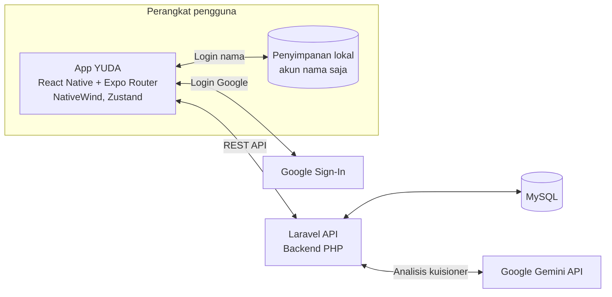

# YUDA — Yuk Udahin Doomscrolling Akut

> Aplikasi pendamping untuk membantu pengguna mengenali, mengatur, dan mengurangi kebiasaan doomscrolling.

---

## 1. Nama Tim

**Mie Ayam 4 Porsi**

## 2. Anggota Tim

| No | Nama |
|----|------|
| 1 | Asyam Rafif Aubin Fawwaz |
| 2 | Gathan Fairuz Izzuddin |
| 3 | Ahmad Royhan Najib |
| 4 | Shevadzikra Ihsan Aimanullah |

## 3. Kategori Lomba

**LOGICODIX Mobile APP — Inclusive Health & Well-being**

## 4. Nama Aplikasi

**YUDA — Yuk Udahin Doomscrolling Akut**

## 5. Deskripsi Solusi

YUDA adalah aplikasi yang membantu pengguna keluar dari kebiasaan doomscrolling, yaitu menggulir layar tanpa henti pada konten negatif atau tidak produktif. Solusi kami bekerja dalam tiga langkah:

1. **Mengenali kebiasaan pengguna.** Saat pertama kali memakai aplikasi, pengguna mengisi kuisioner 10 pertanyaan berbasis jurnal untuk memetakan jam rawan doomscrolling dan tipe doomscrolling mereka (misalnya *night owl* untuk pengguna yang rawan menjelang tidur).
2. **Mengintervensi pada waktu yang tepat.** Pengguna mengatur aplikasi yang dipantau, interval istirahat, dan rencana harian, sehingga pengingat muncul sesuai pola mereka, bukan secara acak.
3. **Memberi umpan balik dan motivasi.** Dasbor harian menampilkan analitik dan ringkasan perilaku, sementara teks afirmasi dipersonalisasi berdasarkan hasil kuisioner.

## 6. Masalah yang Diangkat
 
Doomscrolling adalah kebiasaan menggulir berita atau media sosial secara kompulsif, terutama konten negatif, tanpa mampu berhenti meskipun sudah merasa lelah atau tertekan. Kebiasaan ini diperkuat oleh desain platform, seperti *infinite scroll* dan konten yang disajikan oleh algoritma [2]. Peluang terbentuknya kebiasaan ini besar di Indonesia: pengguna di Indonesia rata-rata menghabiskan 21 jam 50 menit per minggu (lebih dari tiga jam per hari) di media sosial, termasuk untuk menonton video online [5]. Tidak semua waktu tersebut adalah doomscrolling, tetapi angka ini menunjukkan besarnya paparan yang dihadapi pengguna setiap hari.
 
### Dampak pada kesehatan mental
 
- Meta-analisis terbaru pada remaja dan dewasa menemukan bahwa doomscrolling berhubungan dengan kecemasan (r = 0,35), depresi (r = 0,35), distres psikologis (r = 0,51), dan kesejahteraan psikologis yang lebih rendah (r = −0,29) [1].
- Tinjauan *scoping* atas 17 studi empiris menemukan asosiasi yang konsisten dengan kecemasan, depresi, stres, dan menurunnya resiliensi. Penjelasan teoretis yang banyak diajukan adalah ruminasi, kelelahan emosional, dan ketidakmampuan menoleransi ketidakpastian [2].
- Survei terhadap 800 mahasiswa di Iran dan Amerika Serikat menemukan bahwa doomscrolling berhubungan dengan kecemasan eksistensial, yaitu kekhawatiran tentang hidup, kematian, dan makna keberadaan [3].
### Dampak pada produktivitas
 
Bukti yang secara khusus menghubungkan doomscrolling dengan produktivitas masih terbatas. Namun penelitian pada perilaku yang berdekatan, yaitu penggunaan *smartphone* yang bermasalah, menunjukkan pola yang sejalan: meta-analisis atas 29 studi dengan 48.490 partisipan menemukan hubungan negatif dengan prestasi akademik (r = −0,11, efek kecil) [4]. Kelelahan emosional dan menurunnya resiliensi yang dikaitkan dengan doomscrolling [2] juga berpotensi mempersulit seseorang untuk kembali fokus pada tugas. Selain itu, waktu yang terserap untuk menggulir otomatis mengurangi waktu untuk belajar, bekerja, dan beristirahat.
 
### Celah yang dijawab YUDA
 
Banyak pengguna menyadari kebiasaan ini tetapi tidak tahu **kapan** mereka paling rawan, **seberapa sering** terjadi, dan **bagaimana** cara menghentikannya secara konsisten. YUDA hadir untuk mengisi celah tersebut dengan memetakan jam rawan pengguna, mengatur jeda istirahat, dan memberikan umpan balik harian.
 
> **Catatan:** sebagian besar bukti di atas bersifat korelasional (*cross-sectional*), sehingga menunjukkan adanya hubungan, bukan sebab-akibat [1][2]. YUDA tidak mengklaim mengobati gangguan kesehatan mental; YUDA membantu pengguna mengenali dan mengatur kebiasaan menggulir mereka.
 
### Referensi
 
1. Li, Q., & Yin, X. (2026). Doomscrolling, mental health, and psychological well-being in adolescents and adults: a systematic review and meta-analysis. *Frontiers in Psychology*. https://doi.org/10.3389/fpsyg.2026.1893800
2. Sharpe, A. T. R., Tyndall, I., Poulus, D. R., Obine, E. A. C., & Sharpe, B. T. (2026). The influence of doomscrolling on mental health: a scoping review. *Mental Health and Digital Technologies, 3*(3), 290–342. https://doi.org/10.1108/MHDT-10-2025-0068
3. Shabahang, R., Hwang, H., Thomas, E. F., Aruguete, M. S., McCutcheon, L. E., Orosz, G., Khanzadeh, A. A. H., Chirani, B. M., & Zsila, Á. (2024). Doomscrolling evokes existential anxiety and fosters pessimism about human nature? Evidence from Iran and the United States. *Computers in Human Behavior Reports, 15*, 100438. https://doi.org/10.1016/j.chbr.2024.100438
4. Paterna, A., Alcaraz-Ibáñez, M., Aguilar-Parra, J. M., Salavera, C., Demetrovics, Z., & Griffiths, M. D. (2024). Problematic smartphone use and academic achievement: A systematic review and meta-analysis. *Journal of Behavioral Addictions, 13*(2), 313–326. https://doi.org/10.1556/2006.2024.00014
5. We Are Social & Meltwater. (2025). *Digital 2026: Top digital and social media trends in Indonesia*. https://wearesocial.com/id/blog/2025/11/digital-2026-top-digital-and-social-media-trends-in-indonesia/

## 7. Target Pengguna

- Pelajar dan mahasiswa yang sering terdistraksi media sosial
- Pekerja muda yang ingin mengurangi screen time
- Siapa pun yang merasa sulit berhenti menggulir layar

---

## 8. Dokumentasi

### a. Daftar Fitur yang Berhasil Diimplementasikan

| No | Fitur | Deskripsi |
|----|-------|-----------|
| 1 | **Login Page** | Masuk menggunakan akun Google, atau akun lokal dengan hanya memasukkan nama. |
| 2 | **Personalization Page** | Pengguna menyesuaikan pengalaman aplikasi. Pada halaman ini, aplikasi meminta pengguna untuk mengisi nama panggilan. |
| 3 | **App Permission Page** | Meminta dan menjelaskan izin yang dibutuhkan aplikasi. Izin aplikasi yang diminta antara lain: <br>- Tampil di atas aplikasi lain.<br>- Berjalan di latar belakang.<br>- Mengirimkan notifikasi. |
| 4 | **App Preferences Page** | Pengguna memilih aplikasi yang ingin dipantau/dibatasi. |
| 5 | **Break Interval Configuration Page** | Pengguna mengatur durasi atau interval istirahat dari aktivitas menggulir (scrolling) konten media sosial. |
| 6 | **Kuisioner Page** | Kuisioner onboarding berisi 9 pertanyaan untuk menentukan jam rawan doomscrolling, tipe doomscrolling berdasarkan jam rawan, dan personalisasi teks afirmasi. |
| 7 | **Profile Page** | Menampilkan dan mengelola data profil pengguna. |
| 8 | **Daily Planner Page** | Perencanaan aktivitas harian sebagai alternatif dari scrolling. |
| 9 | **Daily Analytics Dashboard Page** | Visualisasi data penggunaan harian. [ISI: sebutkan metrik, mis. durasi, frekuensi, jam puncak] |
| 10 | **Daily Overview Dashboard Page** | Ringkasan kondisi dan progres pengguna hari itu. Panel emosi pengguna yang dirasakan, card informasi jam rawan doomscrolling, metrik penggunaan aplikasi dengan screentime terbanyak, daftar aktivitas harian berdasarkan halaman **Daily Planner Page** |

> Tambahkan tangkapan layar tiap halaman di folder `docs/screenshots/` lalu tautkan di sini, contoh: ``.

### b. Teknologi yang Digunakan

| Kategori | Teknologi |
|----------|-----------|
| Framework | Mobile APP: React Native, Backend API: Laravel, Style: Nativewind |
| Bahasa | Typescript, Kotlin, PHP |
| Library utama | Expo Router, Expo Secure Store, Zustand, Google Sign-in|
| Database | MySQL |
| Autentikasi | Google Sign-In ( @react-native-google-signin/google-signin: ^17.0.0 ) |
| API Internal | REST API Laravel dengan autentikasi token Laravel Sanctum (daftar endpoint di bawah) |
| API Eksternal | Google Sign-In (autentikasi)<br>Google Gemini API: <br>- analisis kuisioner; model: `gemini-3.5-flash-lite` <br>- fallback; model: `gemini-3.5-flash` |
| Layanan pihak ketiga | [ISI: hosting, notifikasi, analitik, dll. Tulis "tidak ada" jika memang tidak ada] |

**Penyimpanan data hybrid**
 
| Mode login | Lokasi penyimpanan data | Catatan |
|------------|-------------------------|---------|
| Google | Database MySQL di server (via Laravel API) | Data tetap tersimpan meski aplikasi dihapus, selama pengguna login dengan akun yang sama. |
| Nama (akun lokal) | Hanya di perangkat | Tidak ada data yang dikirim ke server. Jika data aplikasi dihapus, seluruh data pengguna ikut hilang. |

**Daftar endpoint API internal** (Laravel, prefix `/api`)
 
| Metode | Endpoint | Autentikasi | Fungsi |
|--------|----------|-------------|--------|
| POST | `/auth/google/exchange` | Tidak ada (*throttle* 10 request/menit) | Menukar data autentikasi Google menjadi token akses Sanctum. |
| POST | `/auth/google/native` | Tidak ada (*throttle* 10 request/menit) | Login dari aplikasi mobile menggunakan hasil Google Sign-In native, mengembalikan token Sanctum. |
| GET | `/user` | Bearer token (Sanctum) | Mengambil data pengguna yang sedang login. |
| POST | `/auth/logout` | Bearer token (Sanctum) | Menghapus token akses saat ini (logout). |
| POST | `/ai/questionnaire` | Bearer token (Sanctum) | Menganalisis jawaban kuisioner menggunakan Google Gemini API. |

### c. Diagram Arsitektur Sistem dan Alur Data
 
**Arsitektur sistem**
 

 
**Alur data**
 
*Mode Google (data tersimpan di server)*
 
1. Pengguna menekan login Google. Aplikasi meminta autentikasi ke Google Sign-In dan menerima token.
2. Aplikasi mengirim token ke Laravel API. Backend memverifikasinya, lalu membuat atau mengambil data pengguna di MySQL.
3. Pengguna menyelesaikan personalisasi, izin aplikasi, preferensi aplikasi, interval istirahat, dan kuisioner onboarding. Seluruh data dikirim ke backend dan disimpan di MySQL.
4. Jawaban kuisioner dikirim ke endpoint `/api/ai/questionnaire`. Backend meneruskannya ke Google Gemini API untuk dianalisis, lalu hasilnya (jam rawan, tipe, afirmasi) dikembalikan ke aplikasi dan menjadi dasar pengingat serta teks afirmasi. [ISI: konfirmasi apakah hasil analisis juga disimpan di MySQL]
5. Data penggunaan harian diolah dan ditampilkan pada dasbor analitik dan ringkasan harian.

*Mode lokal (data hanya di perangkat)*
 
1. Pengguna memasukkan nama, tanpa autentikasi dan tanpa request ke server.
2. Seluruh data (hasil kuisioner, preferensi, rencana harian) disimpan di penyimpanan lokal perangkat dan dibaca langsung oleh aplikasi. [ISI: jelaskan bagaimana hasil kuisioner ditentukan di mode ini, karena endpoint `/ai/questionnaire` memerlukan login]
3. Jika data aplikasi dihapus, seluruh data pengguna ikut hilang.

[ISI: sesuaikan jika ada alur lain, mis. sinkronisasi, notifikasi, atau layanan latar belakang]

### d. Panduan Instalasi, Konfigurasi, dan Menjalankan Aplikasi

**Prasyarat**

- [ISI: mis. Node.js versi X / PHP versi X / Flutter SDK versi X]
- [ISI: database yang harus tersedia]
- Akun Google Cloud Console untuk membuat OAuth Client ID

**Langkah instalasi**

```bash
# 1. Clone repository
git clone [ISI: URL repository]
cd [ISI: nama folder]

# 2. Instal dependensi
[ISI: mis. npm install / composer install / flutter pub get]

# 3. Salin file environment lalu isi nilainya
cp .env.example .env

# 4. Siapkan database
[ISI: mis. npx prisma migrate dev / php artisan migrate --seed]

# 5. Jalankan aplikasi
[ISI: mis. npm run dev / php artisan serve / flutter run]
```

**Konfigurasi tambahan untuk fitur tertentu**

| Fitur | Konfigurasi yang diperlukan |
|-------|-----------------------------|
| Login Google | Buat OAuth Client ID di Google Cloud Console, daftarkan *redirect URI* / *authorized origin*, lalu isi `GOOGLE_CLIENT_ID` (dan secret jika diperlukan). |
| App Permission | [ISI: izin yang harus diaktifkan manual di perangkat, mis. akses data penggunaan, notifikasi] |
| Notifikasi / Break Interval | [ISI: konfigurasi tambahan jika ada] |

### e. Daftar Variabel `.env` Movile APP

| Variabel | Deskripsi | Contoh nilai |
|----------|-----------|--------------|
| `EXPO_PUBLIC_API_URL` | Client ID OAuth Google untuk autentikasi | `http://192.xxx.x.x:8000` |
| `EXPO_PUBLIC_GOOGLE_WEB_CLIENT_ID` | Client secret OAuth Google | `xxxxxxxx.apps.googleusercontent.com` |
| `EXPO_PUBLIC_GOOGLE_ANDROID_CLIENT_ID` | [ISI: koneksi database] | `xxxxxxxx.apps.googleusercontent.com` |

### f. Daftar Variabel `.env` Backend API

| Variabel | Deskripsi | Contoh nilai |
|----------|-----------|--------------|
| `APP_NAME` | Nama aplikasi backend. | `YUDA` |
| `APP_ENV` | Lingkungan tempat aplikasi dijalankan. | `local` |
| `APP_KEY` | Kunci enkripsi aplikasi Laravel. | `base64:xxxxxxxxxxx` |
| `APP_DEBUG` | Mengaktifkan atau menonaktifkan mode debugging. | `true` |
| `APP_URL` | URL utama backend Laravel. | `http://localhost:8000` |
| `DB_CONNECTION` | Driver database yang digunakan. | `mysql` |
| `DB_HOST` | Host server database. | `	127.0.0.1` |
| `DB_PORT` | Port koneksi database. | `3306` |
| `DB_DATABASE` | Nama database aplikasi. | `yudabackend` |
| `DB_USERNAME` | Username untuk autentikasi database. | `root` |
| `DB_PASSWORD` | Password untuk autentikasi database. | `-` |
| `GOOGLE_CLIENT_ID` | Client ID untuk integrasi Google Sign-In. | `[ISI]` |
| `GOOGLE_CLIENT_SECRET` | Client Secret untuk autentikasi Google pada backend. | `[ISI]` |
| `GOOGLE_REDIRECT_URI` | URL callback setelah proses autentikasi Google. | `http://localhost:8000/auth/google/callback` |
| `MOBILE_APP_SCHEME` | Skema URL untuk mengarahkan kembali pengguna ke aplikasi mobile. | `yuda` |
| `EXPO_PUBLIC_API_URL` | URL API backend yang diakses oleh aplikasi mobile Expo. | `http://10.x.x.x:8000` |

### g. Akun Demonstrasi

| Jenis akun | Cara masuk |
|------------|-----------|
| **Autentikasi Google** | Login dengan akun Google. [ISI: cantumkan email akun demo yang disediakan untuk juri, jika ada. Jangan cantumkan password di README publik; kirim lewat kanal yang diminta panitia] |
| **Akun lokal** | Tidak memerlukan kredensial. Pengguna hanya diminta memasukkan **nama**. |

### h. Dokumentasi Penggunaan AI

| Tool AI | Digunakan untuk | Bagian proyek | Bagaimana hasilnya diverifikasi/diadaptasi |
|---------|-----------------|---------------|---------------------------------------------|
| Claude (Anthropic) | Merancang 10 pertanyaan kuisioner onboarding berbasis jurnal beserta kerangka output (jam rawan, tipe, afirmasi) | Kuisioner Page | [ISI: mis. pertanyaan dicocokkan dengan jurnal rujukan dan disederhanakan agar mudah dipahami] |
| Claude (Anthropic) | Menyusun README ini | Dokumentasi | Dilengkapi dan diperiksa ulang oleh tim |
| [ISI: tool lain] | [ISI] | [ISI] | [ISI] |

[ISI: tambahkan seluruh penggunaan AI lain secara jujur (kode, desain, aset, teks), termasuk tool dan versinya jika diketahui]

### i. Atribusi Template, Aset, Dataset, dan Kode Pihak Ketiga

| Jenis | Nama | Sumber / URL | Lisensi |
|-------|------|--------------|---------|
| Template | [ISI atau "tidak ada"] | [ISI] | [ISI] |
| Ikon / ilustrasi | [ISI] | [ISI] | [ISI] |
| Font | [ISI] | [ISI] | [ISI] |
| Dataset | [ISI atau "tidak ada"] | [ISI] | [ISI] |
| Kode / library pihak ketiga | [ISI: daftar dari file dependensi proyek] | [ISI] | [ISI] |
| Jurnal rujukan kuisioner | [ISI: daftar jurnal yang menjadi dasar pertanyaan] | [ISI] | — |

---

## Lisensi

[ISI: lisensi proyek, jika ada]