# YUDA — Yuk Udahin Doomscrolling Akut

> Aplikasi pendamping untuk membantu pengguna mengenali, mengatur, dan mengurangi kebiasaan doomscrolling.

---

## 1. Nama Tim

**Mie Ayam 4 Porsi**

## 2. Anggota Tim

| No | Nama |
|----|------|
| 1 | Asyam Rafif Aubin Fawwaz |
| 2 | Gathan Fairuz Izzuddin |
| 3 | Ahmad Royhan Najib |
| 4 | Shevadzikra Ihsan Aimanullah |

## 3. Kategori Lomba

**LOGICODIX Mobile APP — Inclusive Health & Well-being**

## 4. Nama Aplikasi

**YUDA — Yuk Udahin Doomscrolling Akut**

## 5. Deskripsi Solusi

YUDA adalah aplikasi yang membantu pengguna keluar dari kebiasaan doomscrolling, yaitu menggulir layar tanpa henti pada konten negatif atau tidak produktif. Solusi kami bekerja dalam empat langkah:

1. **Mengenali kebiasaan pengguna.** Saat pertama kali memakai aplikasi, pengguna mengisi kuisioner 10 pertanyaan berbasis jurnal untuk memetakan jam rawan doomscrolling dan tipe doomscrolling mereka (misalnya *night owl* untuk pengguna yang rawan menjelang tidur).
2. **Mengintervensi pada waktu yang tepat.** Pengguna mengatur aplikasi yang dipantau, interval istirahat, dan rencana harian, sehingga pengingat muncul sesuai pola mereka, bukan secara acak.
3. **Memberi umpan balik dan motivasi.** Dasbor harian menampilkan analitik dan ringkasan perilaku, sementara teks afirmasi dipersonalisasi berdasarkan hasil kuisioner.
4. **Pendekatan Emosional.** YUDA memberikan jeda preventif secara bertahap melalui aktivitas sederhana, seperti latihan pernapasan selama 30 detik, minum air putih, dan melakukan peregangan ringan. Aktivitas ini bertujuan membantu pengguna menyadari durasi scrolling yang berlebihan sekaligus mengalihkan perhatian sejenak dari aktivitas tersebut.

## 6. Masalah yang Diangkat
 
Masalah utama yang diangkat YUDA adalah **doomscrolling**, yaitu kebiasaan menggulir konten negatif secara kompulsif. Agar permasalahannya jelas, berikut alur argumentasi kami.
 
### 1. Perkembangan penggunaan media digital
 
Penggunaan media digital di Indonesia terus bertumbuh. Jumlah identitas pengguna media sosial naik 26% dalam setahun menjadi 180 juta (setara 62,9% populasi). Waktu yang dihabiskan rata-rata 21 jam 50 menit per minggu, atau lebih dari tiga jam per hari, untuk media sosial termasuk menonton video online, dan tersebar di rata-rata 7,7 platform per bulan [1].
 
### 2. Munculnya perilaku scrolling yang sulit dikendalikan
 
Di tengah paparan setinggi itu, muncul perilaku scrolling yang sulit dikendalikan. Dalam dokumen ini kami menyebutnya ***compulsive scrolling***: menggulir konten berulang-ulang tanpa tujuan yang jelas dan sulit dihentikan, bahkan ketika pengguna sudah ingin berhenti.
 
Desain platform ikut berperan. Studi pada layanan video pendek menemukan bahwa fitur *infinite scroll* berkaitan dengan persepsi hilangnya kendali diri, yang kemudian memunculkan rasa menyesal dan menurunnya keterlibatan kognitif [2]. Penggunaan media sosial yang kompulsif juga dikaitkan dengan kelelahan bermedia sosial, yang selanjutnya berkaitan dengan meningkatnya kecemasan dan depresi [3].
 
> **Catatan istilah:** *compulsive scrolling* adalah istilah operasional yang kami pakai untuk menjelaskan pola perilaku dasarnya. Literatur memakai istilah yang berdekatan, seperti *compulsive social media use* [3] dan *binge-scrolling* [2].
 
### 3. Doomscrolling sebagai salah satu bentuk compulsive scrolling
 
Doomscrolling adalah salah satu bentuk compulsive scrolling, yaitu ketika konten yang digulir bersifat negatif atau mengganggu. Tinjauan *scoping* menggambarkannya sebagai perilaku kebiasaan yang kompulsif dan diperkuat oleh fitur desain seperti *infinite scroll* serta konten yang disajikan algoritma [4].
 
Dengan kata lain, compulsive scrolling menjelaskan pola perilaku yang mendasarinya (sulit berhenti dan dipicu oleh desain platform), sedangkan muatan negatif pada kontennya membuat doomscrolling menjadi permasalahan utama yang ingin diatasi YUDA.
 
### 4. Dampak terhadap kesejahteraan psikologis
 
- Meta-analisis terbaru pada remaja dan dewasa menemukan bahwa doomscrolling berhubungan dengan kecemasan (r = 0,35), depresi (r = 0,35), distres psikologis (r = 0,51), dan kesejahteraan psikologis yang lebih rendah (r = −0,29) [5].
- Tinjauan *scoping* atas 17 studi empiris menemukan asosiasi yang konsisten dengan kecemasan, depresi, stres, dan menurunnya resiliensi. Penjelasan teoretis yang banyak diajukan adalah ruminasi, kelelahan emosional, dan ketidakmampuan menoleransi ketidakpastian [4].
- Survei terhadap 800 mahasiswa di Iran dan Amerika Serikat menemukan bahwa doomscrolling berhubungan dengan kecemasan eksistensial, yaitu kekhawatiran tentang hidup, kematian, dan makna keberadaan [6].
**Dampak pada produktivitas.** Bukti yang secara khusus menghubungkan doomscrolling dengan produktivitas masih terbatas. Namun penelitian pada perilaku yang berdekatan, yaitu penggunaan *smartphone* yang bermasalah, menunjukkan pola yang sejalan: meta-analisis atas 29 studi dengan 48.490 partisipan menemukan hubungan negatif dengan prestasi akademik (r = −0,11, efek kecil) [7]. Kelelahan emosional dan menurunnya resiliensi yang dikaitkan dengan doomscrolling [4] juga berpotensi mempersulit seseorang untuk kembali fokus pada tugas.
 
### 5. Kebutuhan akan solusi yang membantu pengguna mengenali dan mengelola perilakunya
 
Banyak pengguna menyadari kebiasaan ini tetapi tidak tahu **kapan** mereka paling rawan, **seberapa sering** terjadi, dan **bagaimana** cara menghentikannya secara konsisten. Tinjauan Sharpe dkk. menekankan perlunya intervensi kesejahteraan digital yang menyasar pembentukan kebiasaan dan mekanisme penguatan oleh algoritma yang mempertahankan doomscrolling [4]. YUDA hadir untuk memenuhi kebutuhan tersebut melalui pemetaan waktu rawan pengguna, pengaturan jeda istirahat secara berkala, serta pemberian umpan balik harian. Selain itu, YUDA menerapkan jeda preventif secara bertahap melalui aktivitas sederhana, seperti latihan pernapasan selama 30 detik, minum air putih, dan peregangan ringan. Pendekatan ini diharapkan dapat membantu pengguna mengenali pola perilaku scrolling, menyadari ketika telah menghabiskan waktu terlalu lama, serta membangun kebiasaan penggunaan media digital yang lebih sehat.
 
> **Catatan:** sebagian besar bukti di atas bersifat korelasional (*cross-sectional*), sehingga menunjukkan adanya hubungan, bukan sebab-akibat [3][4][5]. YUDA tidak mengklaim mengobati gangguan kesehatan mental; YUDA membantu pengguna mengenali dan mengatur kebiasaan menggulir mereka.
 
### Referensi

> Fokus penelitian dan relevansi tiap referensi dirinci di [docs/references/proposal-background.md](docs/references/proposal-background.md).
 
1. We Are Social & Meltwater. (2025). *Digital 2026: Top digital and social media trends in Indonesia*. https://wearesocial.com/id/blog/2025/11/digital-2026-top-digital-and-social-media-trends-in-indonesia/
2. Park, J., & Jung, Y. (2024). Unveiling the dynamics of binge-scrolling: A comprehensive analysis of short-form video consumption using a Stimulus-Organism-Response model. *Telematics and Informatics, 95*, 102200. https://pure.korea.ac.kr/en/publications/unveiling-the-dynamics-of-binge-scrolling-a-comprehensive-analysi/
3. Dhir, A., Yossatorn, Y., Kaur, P., & Chen, S. (2018). Online social media fatigue and psychological wellbeing: A study of compulsive use, fear of missing out, fatigue, anxiety and depression. *International Journal of Information Management, 40*, 141–152. https://ideas.repec.org/a/eee/ininma/v40y2018icp141-152.html
4. Sharpe, A. T. R., Tyndall, I., Poulus, D. R., Obine, E. A. C., & Sharpe, B. T. (2026). The influence of doomscrolling on mental health: a scoping review. *Mental Health and Digital Technologies, 3*(3), 290–342. https://doi.org/10.1108/MHDT-10-2025-0068
5. Li, Q., & Yin, X. (2026). Doomscrolling, mental health, and psychological well-being in adolescents and adults: a systematic review and meta-analysis. *Frontiers in Psychology*. https://doi.org/10.3389/fpsyg.2026.1893800
6. Shabahang, R., Hwang, H., Thomas, E. F., Aruguete, M. S., McCutcheon, L. E., Orosz, G., Khanzadeh, A. A. H., Chirani, B. M., & Zsila, Á. (2024). Doomscrolling evokes existential anxiety and fosters pessimism about human nature? Evidence from Iran and the United States. *Computers in Human Behavior Reports, 15*, 100438. https://doi.org/10.1016/j.chbr.2024.100438
7. Paterna, A., Alcaraz-Ibáñez, M., Aguilar-Parra, J. M., Salavera, C., Demetrovics, Z., & Griffiths, M. D. (2024). Problematic smartphone use and academic achievement: A systematic review and meta-analysis. *Journal of Behavioral Addictions, 13*(2), 313–326. https://doi.org/10.1556/2006.2024.00014

## 7. Target Pengguna

- Pelajar dan mahasiswa yang sering terdistraksi media sosial
- Pekerja muda yang ingin mengurangi screen time
- Siapa pun yang merasa sulit berhenti menggulir layar

---

## 8. Dokumentasi

### a. Daftar Fitur yang Berhasil Diimplementasikan

| No | Fitur | Deskripsi | Tangkapan Layar |
|----|-------|-----------|-----------------|
| 1 | **Login Page** | Masuk menggunakan akun Google, atau akun lokal dengan hanya memasukkan nama. | 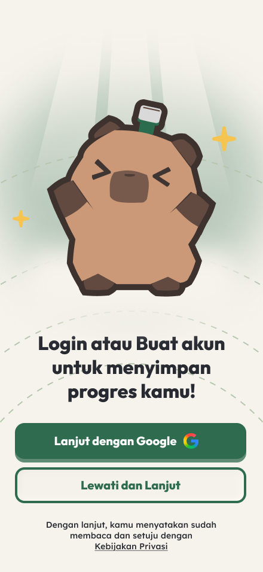 |
| 2 | **Personalization Page** | Pengguna menyesuaikan pengalaman aplikasi. Pada halaman ini, aplikasi meminta pengguna untuk mengisi nama panggilan pengguna. | 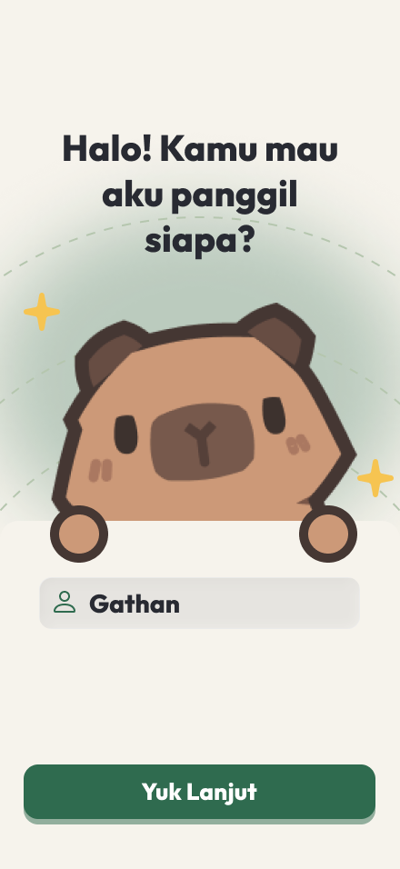 |
| 3 | **App Permission Page** | Meminta dan menjelaskan izin yang dibutuhkan aplikasi. Izin aplikasi yang diminta antara lain: <br>- Tampil di atas aplikasi lain.<br>- Berjalan di latar belakang.<br>- Mengirimkan notifikasi. | 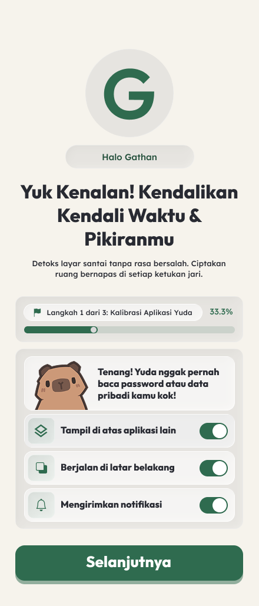 |
| 4 | **App Preferences Page** | Pengguna memilih aplikasi yang ingin dipantau/dibatasi. | 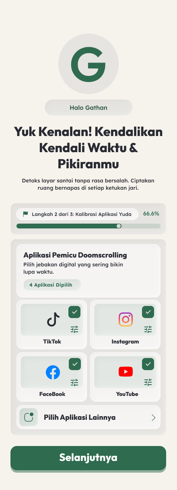 |
| 5 | **Break Interval Configuration Page** | Pengguna mengatur interval scroll (5 sampai 60 menit) dan gaya nada pesan intervensi (lembut, tegas, humoris, faktual, atau reflektif). Durasi jeda (30 sampai 60 detik) disesuaikan otomatis setiap minggu: naik 5 detik jika total screen time 7 hari terakhir lebih tinggi dari 7 hari sebelumnya, turun 5 detik jika lebih rendah. | 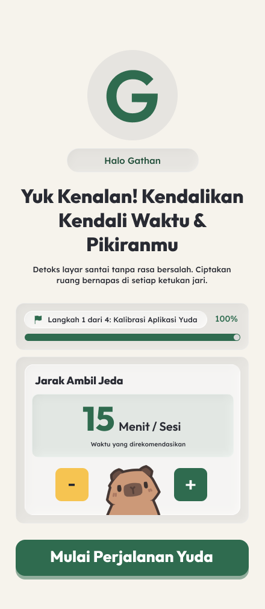 |
| 6 | **Kuisioner Page** | Kuisioner onboarding 10 pertanyaan untuk menentukan jam rawan doomscrolling, tipe doomscrolling berdasarkan jam rawan, dan personalisasi teks afirmasi. | 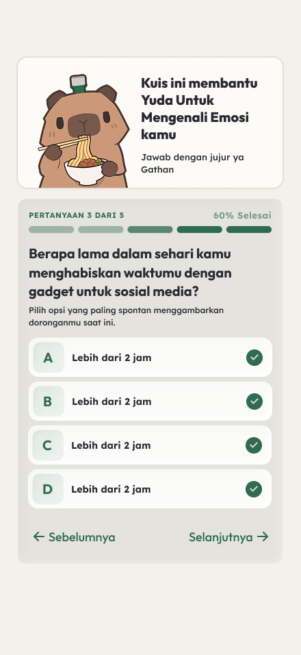 |
| 7 | **Profile Page** | Menampilkan dan mengelola data profil pengguna. | 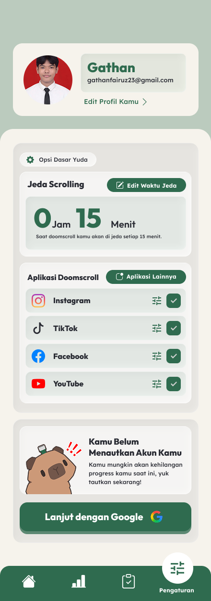 |
| 8 | **Edit Profile Page** | Memungkinkan pengguna untuk memperbarui foto profil, nama panggilan hingga nama lengkap, email, serta tanggal lahir | 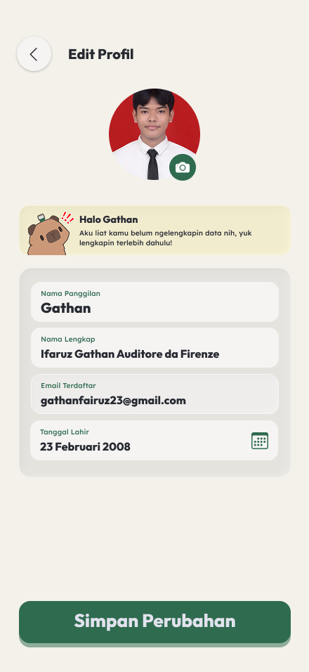 |
| 9 | **Daily Planner Page** | Perencanaan aktivitas harian sebagai alternatif dari scrolling. | 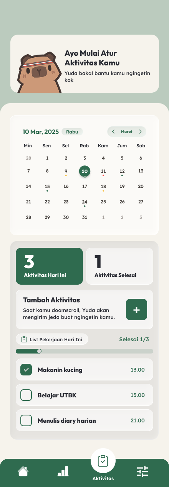 |
| 10 | **Daily Analytics Dashboard Page** | Menampilkan analitik pola penggunaan berdasarkan durasi scrolling melalui visualisasi matriks aktivitas mingguan dengan 12 slot waktu berdurasi 2 jam serta total durasi scrolling harian selama satu bulan. Setiap blok menggunakan gradasi warna untuk merepresentasikan tingkat intensitas scrolling pengguna. | 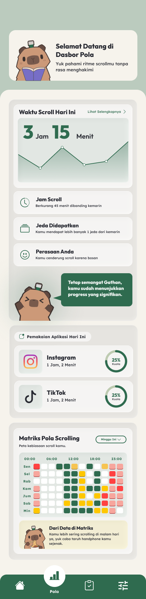 |
| 11 | **Daily Overview Dashboard Page** | Ringkasan kondisi dan progres pengguna hari itu. Panel emosi pengguna yang dirasakan, card informasi jam rawan doomscrolling, metrik penggunaan aplikasi dengan screentime terbanyak, daftar aktivitas harian berdasarkan halaman **Daily Planner Page** | 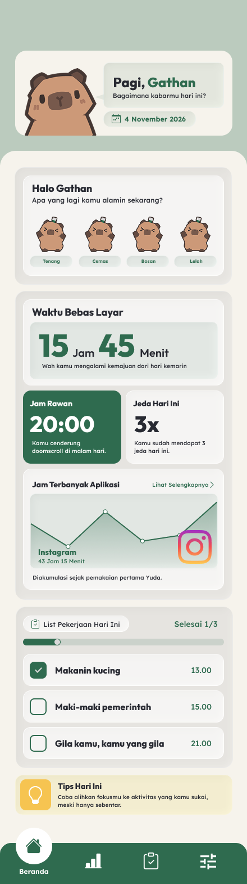 |
| 12 | **Scrolltime Detail Page** | Memungkinkan pengguna mampu melihat detail waktu menggulir(scroll) konten/aplikasi dalam satu hari yang dipilih berdasarkan tanggal | 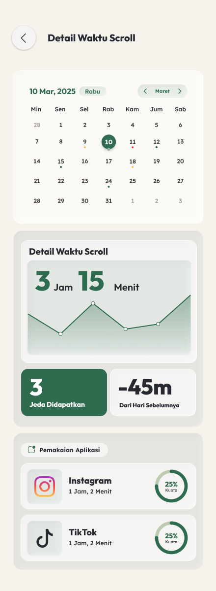 |
| 13 | **Pop Up Jeda Pengingat** | Memberikan pengingat preventif kepada pengguna berdasarkan durasi scrolling melalui sapaan maskot, pilihan aktivitas jeda, pengingat tugas harian, serta pengingat lanjutan setiap 15 menit apabila pengguna memilih untuk tetap scrolling. | 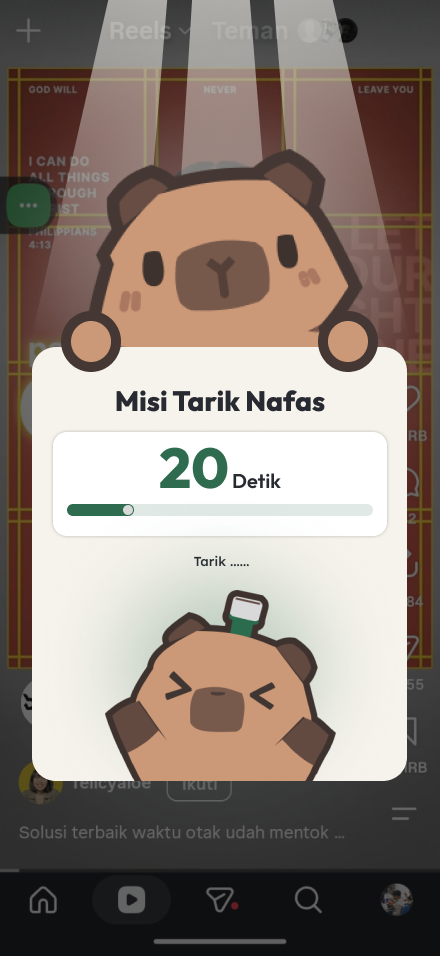 [Selengkapnya](docs/features/POP_UP_JEDA_PENGINGAT.md) |
| 14 | **Pop Up Jeda Kesadaran** | Membantu pengguna mengenali kondisi emosional saat melakukan scrolling pada jam rawan melalui pertanyaan perasaan, kartu afirmasi, tips sederhana, dan rangkaian aktivitas jeda preventif. | 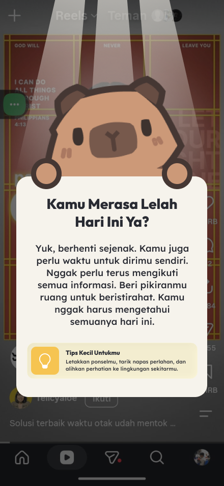 [Selengkapnya](docs/features/POP_UP_JEDA_KESADARAN.md) |
| 15 | **Pop Up Jeda Evaluasi** | Mengajak pengguna mengevaluasi kembali kebiasaan scrolling setelah mengabaikan pengingat jeda sebelumnya melalui pengenalan emosi, kartu afirmasi, aktivitas preventif, dan pengingat lanjutan. | 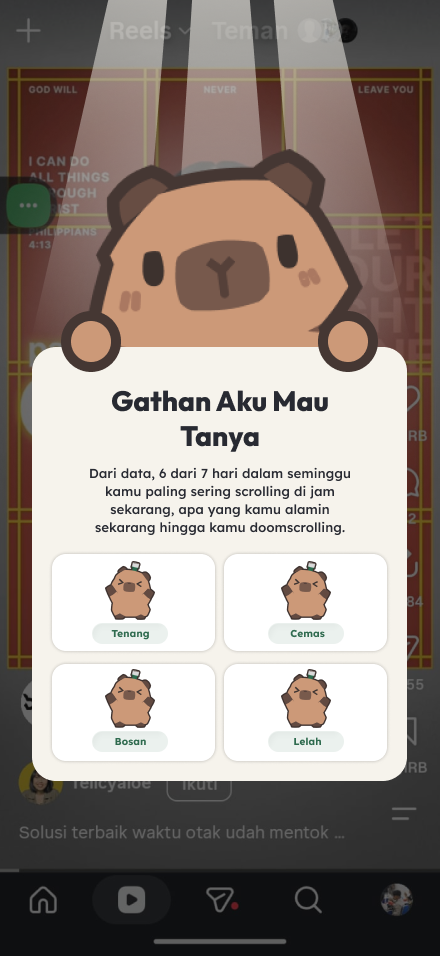 [Selengkapnya](docs/features/POP_UP_JEDA_EVALUASI.md) |

### b. Teknologi yang Digunakan

| Kategori | Teknologi |
|----------|-----------|
| Framework | Mobile APP: React Native, Backend API: Laravel, Style: Nativewind |
| Bahasa | Typescript, Kotlin, PHP |
| Library utama | Mobile: Expo Router, Expo Secure Store, Zustand, Google Sign-In, Tanstack Query, Axios · Backend: Laravel Sanctum, Laravel AI SDK (`laravel/ai`) |
| Database | MySQL (khusus pengguna yang login dengan Google; lihat penyimpanan hybrid di bawah) |
| Autentikasi | Google Sign-In ( @react-native-google-signin/google-signin: ^17.0.0 ) |
| API Internal | REST API Laravel dengan autentikasi token Laravel Sanctum (daftar endpoint di bawah) |
| API Eksternal | Google Sign-In (autentikasi)<br>Google Gemini API: <br>- analisis kuisioner; model: `gemini-3.5-flash-lite` <br>- fallback; model: `gemini-3.5-flash` |
| Layanan pihak ketiga | Google Sign-In, Google Gemini API, Hosting: Dokploy |

**Penyimpanan data hybrid**
 
| Mode login | Lokasi penyimpanan data | Catatan |
|------------|-------------------------|---------|
| Google | Database MySQL di server (via Laravel API) | Data tetap tersimpan meski aplikasi dihapus, selama pengguna login dengan akun yang sama. |
| Nama (akun lokal) | Penyimpanan lokal React Native di perangkat; fitur tertentu (mis. tugas Daily Planner) tersimpan di database dengan pengenal `guest_uuid` | Selama belum login dengan Google, menghapus data aplikasi membuat pengguna kehilangan akses ke seluruh datanya. Setelah pengguna login dengan Google, data disimpan di database. |
 
**Daftar endpoint API internal** (Laravel, prefix `/api`)
 
| Metode | Endpoint | Autentikasi | Fungsi |
|--------|----------|-------------|--------|
| POST | `/auth/google/exchange` | Tidak ada (*throttle* 10 request/menit) | Menukar data autentikasi Google menjadi token akses Sanctum. |
| POST | `/auth/google/native` | Tidak ada (*throttle* 10 request/menit) | Login dari aplikasi mobile menggunakan hasil Google Sign-In native, mengembalikan token Sanctum. |
| PATCH | `/user/profile` | Bearer token (Sanctum) | Memperbarui data profil pengguna (Profile Page). |
| GET | `/user` | Bearer token (Sanctum) | Mengambil data pengguna yang sedang login. |
| POST | `/auth/logout` | Bearer token (Sanctum) | Menghapus token akses saat ini (logout). |
| GET | `/questionnaire` | Publik | Mengambil definisi kuisioner onboarding untuk ditampilkan di aplikasi (Kuisioner Page). |
| POST | `/questionnaire/analyze` | Publik (untuk pengguna tamu) | Menganalisis jawaban kuisioner pengguna tamu dengan alur yang sama (cache pola, Gemini, fallback), tanpa percakapan dan tanpa dikaitkan dengan akun. |
| POST | `/ai/questionnaire` | Bearer token (Sanctum) | Menganalisis jawaban kuisioner pengguna login: cache pola, lalu Google Gemini, lalu fallback berbasis aturan. Percakapan disimpan untuk pengguna tersebut. |
| POST | `/ai/questionnaire/feedback` | Bearer token (Sanctum) | Mengirim umpan balik apakah hasil analisis sesuai (`is_suitable`), dengan catatan opsional. Dicatat ke log server. |
| POST | `/intervention/matrix` | Bearer token (Sanctum) atau `guest_uuid` | Menyimpan atau memperbarui (*upsert*) matriks screen time harian per tanggal (`log_date`): 12 slot berdurasi 2 jam dalam menit (kunci `slot_00_02` sampai `slot_22_00`, nilai 0 sampai 120), total harian dihitung otomatis, serta jumlah intervensi yang terpicu dan waktu per platform. |
| GET | `/intervention/matrix` | Bearer token (Sanctum) atau `guest_uuid` | Mengambil riwayat matriks harian: per minggu (dengan rincian 12 slot) atau per bulan (hanya total harian dan jumlah intervensi), dengan parameter `range`, `date`, atau `month`. |
| GET | `/intervention/random-message` | Publik | Mengambil satu pesan intervensi (kartu "Cukup Tau") dengan pencocokan bertingkat berdasarkan *emotion*, *trigger_condition*, dan *tone_style* dari pool pesan generasi aktif. Memakai pesan bawaan jika pool kosong. |
| POST | `/intervention/messages` | Publik | Menambahkan pesan intervensi, satu objek atau banyak sekaligus (`messages[]`), lengkap dengan *emotion*, *trigger_condition*, *tone_style*, header, isi, tips, dan *micro habit* (minum, tidur, napas, peregangan). |
| DELETE | `/intervention/messages/{id}` | Publik | Menghapus pesan intervensi berdasarkan ID. |
| GET | `/intervention/settings` | Bearer token (Sanctum) | Mengambil pengaturan intervensi: *tone_style*, interval scroll (menit), durasi jeda saat ini dan terakhir (detik), serta waktu evaluasi terakhir. |
| POST | `/intervention/settings` | Bearer token (Sanctum) | Memperbarui interval scroll (5 sampai 60 menit) dan *tone_style* (lembut, tegas, humoris, faktual, reflektif). |
| GET | `/screen-time/social` | Bearer token (Sanctum) atau `guest_uuid` | Mengambil total screen time per platform (Instagram, TikTok, Facebook, Threads, YouTube, X). |
| POST | `/screen-time/social` | Bearer token (Sanctum) atau `guest_uuid` | Menambahkan (mengakumulasi) screen time per platform. Minimal satu platform harus dikirim, bernilai bilangan bulat ≥ 0. Satuan waktu yang disimpan adalah menit. |
| GET | `/tasks` | Bearer token (Sanctum) atau `guest_uuid` | Mengambil daftar tugas (Daily Planner Page), dengan filter tanggal opsional dan ringkasan tugas hari ini. |
| POST | `/tasks` | Bearer token (Sanctum) atau `guest_uuid` | Membuat tugas baru (judul, tanggal, dan jam opsional). |
| PUT | `/tasks/{id}` | Bearer token (Sanctum) atau `guest_uuid` | Memperbarui judul, tanggal, atau jam tugas. |
| PATCH | `/tasks/{id}/complete` | Bearer token (Sanctum) atau `guest_uuid` | Menukar (*toggle*) status selesai tugas. |
| DELETE | `/tasks/{id}` | Bearer token (Sanctum) atau `guest_uuid` | Menghapus tugas. |
 
### c. Diagram Arsitektur Sistem dan Alur Data
 
**Arsitektur sistem**
 
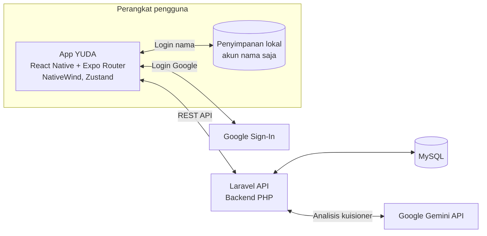
 
**Alur data**
 
**Mode Google (data tersimpan di server)**
 
1. Pengguna menekan login Google. Aplikasi meminta autentikasi ke Google Sign-In dan menerima token.
2. Aplikasi mengirim token ke Laravel API. Backend memverifikasinya, lalu membuat atau mengambil data pengguna di MySQL.
3. Pengguna menyelesaikan personalisasi, izin aplikasi, preferensi aplikasi, interval istirahat, dan kuisioner onboarding. Seluruh data dikirim ke backend dan disimpan di MySQL.
4. Jawaban kuisioner dikirim ke `/api/ai/questionnaire`. Backend menganalisisnya dengan tiga lapis: (a) mencari hasil analisis untuk pola jawaban yang sama di tabel cache pola (respons instan); (b) jika belum ada, memanggil Google Gemini dengan model utama dan model cadangan serta batas waktu yang dapat dikonfigurasi; (c) jika Gemini gagal, kelebihan beban, atau melewati batas waktu, memakai generator fallback berbasis aturan sehingga pengguna tetap menerima hasil. Hasil (jam rawan, tipe, afirmasi) dikembalikan ke aplikasi dan menjadi dasar pengingat serta teks afirmasi. Hasil analisis disimpan di MySQL sebagai cache pola, dan percakapan pengguna disimpan melalui *conversation store* Laravel AI SDK.
5. Data penggunaan harian diolah dan ditampilkan pada dasbor analitik dan ringkasan harian.

**Mode tamu (data di perangkat sampai pengguna login Google)**
 
1. Pengguna memasukkan nama tanpa autentikasi Google, sehingga tidak ada token Sanctum. Untuk fitur yang memerlukan server, tamu diidentifikasi dengan `guest_uuid` (header `X-Guest-UUID` atau isi request).
2. Data pengguna (nama, preferensi, hasil kuisioner) disimpan di penyimpanan lokal React Native pada perangkat.
3. Jawaban kuisioner dikirim ke `/api/questionnaire/analyze`. Alurnya sama dengan pengguna login (cache pola, lalu Gemini, lalu fallback), tetapi tanpa `user_id` dan tanpa percakapan yang disimpan. Hasil analisis dan jawaban yang dinormalisasi tetap disimpan sebagai cache pola di database tanpa dikaitkan dengan `guest_uuid`, sehingga jawaban dengan pola yang sama dapat memakai hasil yang sudah ada.
4. Tugas Daily Planner (`/api/tasks`), screen time media sosial (`/api/screen-time/social`), dan matriks screen time harian (`/api/intervention/matrix`) dikirim dengan `guest_uuid` dan disimpan di database dengan pengenal tersebut, bukan `user_id`. Request ke `/api/tasks` dan `/api/screen-time/social` tanpa token Sanctum maupun `guest_uuid` ditolak dengan HTTP 401. Pengaturan intervensi (`/api/intervention/settings`) hanya tersedia untuk pengguna login.
5. Selama belum login dengan Google, menghapus data aplikasi membuat pengguna kehilangan akses ke seluruh datanya.
6. Ketika pengguna melakukan login menggunakan Google, seluruh data yang sebelumnya tersimpan secara lokal di perangkat React Native akan secara otomatis dimigrasikan ke database server MySQL dan dikaitkan dengan akun Google pengguna. Selanjutnya, pengguna dapat melanjutkan penggunaan aplikasi melalui mode Google tanpa kehilangan data maupun progres sebelumnya.

**Alur intervensi (semua pengguna)**
 
1. Aplikasi mengirim matriks screen time harian ke `/api/intervention/matrix`. Total harian dihitung otomatis dari 12 slot.
2. Setiap minggu, sistem membandingkan total screen time 7 hari terakhir dengan 7 hari sebelumnya, lalu menyesuaikan durasi jeda pengguna (30 sampai 60 detik, langkah 5 detik). Logika ini diimplementasikan di `InterventionService::evaluateWeeklyProgress` yang membandingkan akumulasi `UserDailyScreenTimeMatrix` 7 hari terakhir terhadap 7 hari sebelumnya. Jika screen time meningkat, jeda ditambah 5 detik (maksimal 60 detik); jika menurun, jeda dikurangi 5 detik sebagai reward (minimal 30 detik), lalu mencatat timestamp `last_evaluated_at`. Nilai durasi jeda yang telah diperbarui disinkronkan ke aplikasi mobile melalui endpoint `GET /api/intervention/settings` (field `current_pause_duration`).
3. Saat pemicu terjadi (jam rawan, scroll terlalu lama, atau *check-in* dashboard), aplikasi memanggil `/api/intervention/random-message` dengan *emotion*, *trigger_condition*, dan *tone_style*. Backend memilih pesan dari pool generasi aktif dengan pencocokan bertingkat, dan memakai pesan bawaan jika pool kosong.
4. Pool pesan diperbarui setiap minggu (periode ISO, zona waktu Asia/Jakarta): sistem membangun 60 kombinasi (4 emosi × 3 pemicu × 5 nada), membaginya menjadi 12 batch yang diproses lewat Laravel Queue, dan menghasilkan 3 variasi per kombinasi, total 180 pesan. Setelah semua batch selesai dan lolos validasi ketat (field wajib, nilai enum, tepat 180 pesan dan 60 kombinasi), generasi baru diaktifkan secara atomik dalam satu transaksi database dan generasi sebelumnya diarsipkan. Jika ada batch yang gagal, generasi baru tidak diaktifkan dan generasi sebelumnya tetap dipakai. Penjadwalan ini dijalankan secara otomatis oleh Laravel Scheduler (`routes/console.php`) melalui command `yuda:generate-weekly-interventions` setiap hari **Senin pukul 02:00 WIB** (`Asia/Jakarta`) dengan proteksi `withoutOverlapping()`. Adapun metode rotasi lama (`rotatePoolWithAi` dan perintah `yuda:rotate-intervention-messages` yang merotasi 10 pesan manual) sudah **berstatus *legacy* dan tidak lagi digunakan oleh *scheduler*** karena sistem pemilihan pesan (`getRandomMessage`) kini terkunci pada `generation_id` generasi aktif mingguan.

> **Catatan privasi:** jawaban kuisioner diproses oleh Google Gemini. Hasil analisis dan jawaban yang dinormalisasi disimpan sebagai cache pola di database tanpa dikaitkan dengan akun maupun `guest_uuid`. Pembuatan pesan intervensi oleh Gemini tidak mengirim data pengguna.
 
**Layanan latar belakang & notifikasi overlay (aplikasi mobile)**

Aplikasi **tidak menggunakan** `expo-notifications` maupun `expo-task-manager`. Sebagai gantinya, seluruh sistem pemantauan dan intervensi dijalankan melalui **modul native Kotlin kustom** (`modules/yuda-pip`) yang terdiri dari dua layanan Android:

1. **`YudaAccessibilityService`** — Layanan aksesibilitas yang berjalan terus-menerus setelah diaktifkan di pengaturan perangkat. Layanan ini:
   - Mendeteksi aplikasi di latar depan (*foreground*) melalui event `TYPE_WINDOW_STATE_CHANGED` dan `TYPE_VIEW_SCROLLED`.
   - Mengenali layar feed/reels/shorts pada aplikasi target (Instagram, TikTok, YouTube, Facebook, Threads) lewat inspeksi *resource ID*, *content description*, dan nama kelas UI (misalnya `ViewPager`).
   - Mengakumulasi durasi scroll dalam `SharedPreferences` (`total_reels_duration_ms`) dan me-reset-nya secara otomatis di awal hari baru.
   - Memiliki deteksi *idle* (5 menit tanpa event scroll → timer berhenti) dan menjeda timer saat layar komentar atau *share sheet* terbuka.
   - Mengirimkan pembaruan timer secara real-time ke `YudaOverlayService` melalui intent.

2. **`YudaOverlayService`** — Layanan latar depan (*foreground service*) yang:
   - Berjalan dengan notifikasi persisten prioritas rendah ("Yuda Pendamping Scrolling — Aktif mendampingi saat kamu membuka …") sebagai syarat Android untuk menjaga layanan tetap hidup.
   - Menerima pembaruan timer dari `YudaAccessibilityService`, menghitung *bucket* waktu (`rawSecondsElapsed / intervalSeconds`), dan memicu alert overlay saat batas interval terlampaui (misalnya setiap 15 menit sesuai pengaturan pengguna).
   - Memiliki mekanisme *fallback polling* (`UsageStatsManager`) jika koneksi aksesibilitas terputus.
   - Dijalankan dengan `START_STICKY` agar bertahan meskipun aplikasi utama di-kill.

**Alur intervensi overlay:**

Saat durasi scroll melewati batas interval, overlay ditampilkan **di atas aplikasi mana pun** menggunakan `WindowManager` + `TYPE_APPLICATION_OVERLAY`:

1. **Fase peeking:** Tangan maskot Yuda muncul dari atas layar secara native (`ImageView`). Otomatis melanjutkan ke modal penuh setelah 3,2 detik, atau langsung jika diketuk.
2. **Fase modal penuh:** Sebuah `ReactSurface` (`"YudaAlertOverlay"`) di-render di dalam overlay native, menampilkan UI React Native layar penuh (`PauseBiasaFlow`). Jika React Native tidak tersedia, digunakan *fallback* tampilan Android native.
3. **Eskalasi bertingkat** berdasarkan `pauseStageLevel`:
   - **Level 1** (pemicu pertama): Sapaan → Pilihan istirahat atau lanjut.
   - **Level 2** (pengguna memilih "lanjut" sebelumnya): Sapaan → Pengantar jeda → Aktivitas terpandu (latihan pernapasan, minum air, peregangan, atau tidur sesuai waktu) dengan *countdown timer* → Misi sukses → Pilihan.
   - **Level 3** (masih lanjut): Sama seperti Level 2, ditambah pengingat daftar tugas harian (*Daily Planner*).
4. **Hasil dismiss:** Memilih "Istirahat Scroll" me-reset level eskalasi ke 1; memilih "Lanjut Scroll" menaikkan level (maks 2) sehingga intervensi berikutnya lebih elaboratif. Timer interval di-reset setelah dismiss.

**Sinkronisasi pengaturan:**

- Saat login Google, pengaturan intervensi lokal (`scroll_interval_minutes`, `tone_style`) dikirim ke `/api/intervention/settings` di server.
- Perubahan interval disimpan secara paralel di tiga tempat: `SecureStore` (React Native), `SharedPreferences` (diakses oleh layanan native melalui `YudaPip.setIntervalMinutes()`), dan server (jika login).
- Daftar aplikasi target (`targetPackages`) disimpan di `SecureStore` dan disinkronkan ke layanan native melalui `YudaPip.setTargetPackages()`.

### d. Panduan Instalasi, Konfigurasi, dan Menjalankan Aplikasi

**Prasyarat**

- **Node.js**: Versi `>= 18.x` (disarankan LTS v20 atau v22) dan package manager `npm` (atau `pnpm`).
- **PHP**: Versi `>= 8.3` (disarankan PHP 8.3 / 8.4) serta **Composer** versi `>= 2.x`.
- **Database**: **MySQL** `>= 8.0` atau MariaDB (tersedia via Laragon, XAMPP, atau Docker).
- **Java Development Kit (JDK)**: OpenJDK 17 atau OpenJDK 21 (diperlukan untuk kompilasi mobile Android).
- **Android SDK & Platform Tools**: Android SDK Command-line Tools, Build-Tools (versi 34/35/36), dan `adb` yang sudah ditambahkan ke *System / User PATH* serta variabel `ANDROID_HOME`.
- **Akun Google Cloud Console**: Untuk membuat OAuth 2.0 Client ID (Web Client ID & Android Client ID) dan Gemini API Key dari Google AI Studio.
- **Perangkat Fisik Android**: HP Android yang terhubung via kabel USB dengan **USB Debugging** aktif (atau Android Emulator).

---

#### 1. Langkah Instalasi Backend API (`yuda-api`)

Buka terminal dan lakukan langkah-langkah berikut:

```bash
# 1. Clone repository
git clone https://github.com/hanNajib/Yuda-Logicodix.git
cd Yuda-Logicodix/yuda-api

# 2. Instal dependensi PHP via Composer
composer install

# 3. Siapkan file konfigurasi environment
cp .env.example .env
php artisan key:generate

# 4. Konfigurasi database dan API Keys di file .env:
#    - Sesuaikan DB_DATABASE=yudabackend, DB_USERNAME, dan DB_PASSWORD
#    - Masukkan GOOGLE_CLIENT_ID, GOOGLE_CLIENT_SECRET
#    - Masukkan GEMINI_API_KEY dari Google AI Studio

# 5. Jalankan migrasi dan seeder database
php artisan migrate --seed
php artisan db:seed --class=InterventionMessageSeeder

# 6. Jalankan server lokal Laravel (Port 8000)
php artisan serve
```

> **Catatan Antrean (Queue Worker):** Buka terminal baru di folder `yuda-api` dan jalankan worker antrean untuk memproses pembuatan pesan intervensi AI secara asinkron:
> ```bash
> php artisan queue:work
> ```

---

#### 2. Langkah Instalasi Mobile APP (`yuda-app`)

Buka terminal baru untuk aplikasi mobile:

```bash
# 1. Masuk ke direktori yuda-app
cd Yuda-Logicodix/yuda-app

# 2. Instal dependensi Node.js
npm install

# 3. Siapkan file konfigurasi environment
cp .env.example .env

# 4. Sesuaikan variabel di file .env:
#    - EXPO_PUBLIC_API_URL:
#      * http://localhost:8000 (jika menggunakan kabel USB + adb reverse)
#      * http://<IP_KOMPUTER>:8000 (jika menggunakan jaringan Wi-Fi lokal yang sama)
#    - EXPO_PUBLIC_GOOGLE_WEB_CLIENT_ID: Client ID Web dari Google Cloud Console
#    - EXPO_PUBLIC_GOOGLE_ANDROID_CLIENT_ID: Client ID Android dari Google Cloud Console

# 5. Hubungkan HP Android ke PC via USB dan lakukan port reverse backend
adb devices
adb reverse tcp:8000 tcp:8000

# 6. Kompilasi dan jalankan aplikasi langsung ke HP Android
npx expo run:android
```

---

**Konfigurasi tambahan untuk fitur tertentu**

| Fitur | Konfigurasi yang diperlukan |
|-------|-----------------------------|
| **Login Google** | 1. Buat project di Google Cloud Console dan siapkan OAuth Consent Screen.<br>2. Buat **Web Client ID** lalu pasang pada `GOOGLE_CLIENT_ID` (backend) dan `EXPO_PUBLIC_GOOGLE_WEB_CLIENT_ID` (mobile).<br>3. Buat **Android Client ID** dengan package name `com.mieayamproject.yuda` dan SHA-1 fingerprint keystore debug komputer Anda, lalu pasang di `EXPO_PUBLIC_GOOGLE_ANDROID_CLIENT_ID`.<br>4. Tambahkan email penguji ke daftar *Test Users* jika status OAuth Consent Screen masih *Testing*. |
| **App Permission** | Seluruh izin berikut dipandu dan diaktifkan manual oleh pengguna pada halaman onboarding *App Permission*:<br>1. **Tampilkan di Atas Aplikasi Lain** (`SYSTEM_ALERT_WINDOW`): Diperlukan agar pop-up intervensi dan animasi peeking maskot Yuda dapat muncul di atas aplikasi media sosial target.<br>2. **Abaikan Optimasi Baterai** (`REQUEST_IGNORE_BATTERY_OPTIMIZATIONS`): Mencegah sistem Android menghentikan *foreground service* pendamping saat layar mati atau memori menipis.<br>3. **Izin Notifikasi** (`POST_NOTIFICATIONS`): Diperlukan Android 13+ untuk menampilkan notifikasi persisten layanan pendamping scrolling.<br>4. **Layanan Aksesibilitas** (`YudaAccessibilityService`): Wajib diaktifkan manual di menu *Aksesibilitas / Accessibility* perangkat agar aplikasi dapat mendeteksi reels, shorts, dan aktivitas scroll pada aplikasi target secara real-time. |
| **Notifikasi / Break Interval** | 1. Pengguna mengonfigurasi batas interval scrolling (5 sampai 60 menit) dan memilih aplikasi target (Instagram, TikTok, YouTube, Facebook, Threads) di halaman *App Preferences* dan *Set Timer*.<br>2. Jika HP dihubungkan ke komputer melalui kabel USB, pastikan perintah `adb reverse tcp:8000 tcp:8000` telah dijalankan agar aplikasi di HP dapat berkomunikasi dengan backend Laravel lokal di `http://localhost:8000`. |

### e. Daftar Variabel `.env` Mobile APP

| Variabel | Deskripsi | Contoh nilai |
|----------|-----------|--------------|
| `EXPO_PUBLIC_API_URL` | URL dasar backend API Laravel yang diakses oleh aplikasi mobile. | `http://localhost:8000` atau `http://192.168.x.x:8000` |
| `EXPO_PUBLIC_GOOGLE_WEB_CLIENT_ID` | Client ID OAuth 2.0 untuk platform Web yang digunakan dalam konfigurasi autentikasi Google, termasuk proses verifikasi token ID Google pada backend. | `xxxxxxxx.apps.googleusercontent.com` |
| `EXPO_PUBLIC_GOOGLE_ANDROID_CLIENT_ID` | Client ID OAuth 2.0 khusus aplikasi Android yang digunakan dalam konfigurasi autentikasi Google pada perangkat Android. | `xxxxxxxx.apps.googleusercontent.com` |

### f. Daftar Variabel `.env` Backend API

| Variabel | Deskripsi | Contoh nilai |
|----------|-----------|--------------|
| `APP_NAME` | Nama aplikasi backend. | `YUDA` |
| `APP_ENV` | Lingkungan tempat aplikasi dijalankan. | `local` |
| `APP_KEY` | Kunci enkripsi aplikasi Laravel. | `base64:xxxxxxxxxxx` |
| `APP_DEBUG` | Mengaktifkan atau menonaktifkan mode debugging. | `true` |
| `APP_URL` | URL utama backend Laravel. | `http://localhost:8000` |
| `DB_CONNECTION` | Driver database yang digunakan. | `mysql` |
| `DB_HOST` | Host server database. | `127.0.0.1` |
| `DB_PORT` | Port koneksi database. | `3306` |
| `DB_DATABASE` | Nama database aplikasi. | `yudabackend` |
| `DB_USERNAME` | Username untuk autentikasi database. | `root` |
| `DB_PASSWORD` | Password untuk autentikasi database. | `-` |
| `GOOGLE_CLIENT_ID` | Client ID untuk integrasi Google Sign-In. | `xxxxxxxxxxxx.apps.googleusercontent.com` |
| `GOOGLE_CLIENT_SECRET` | Client Secret untuk autentikasi Google pada backend. | `GOCSPX-xxxxxxxxx` |
| `GOOGLE_REDIRECT_URI` | URL callback setelah proses autentikasi Google. | `http://localhost:8000/auth/google/callback` |
| `GEMINI_API_KEY` | API key Google Gemini untuk analisis kuisioner. Dibuat di Google AI Studio dan tidak boleh di-commit ke repository. | `xxxxxxxxx` | 
| `MOBILE_APP_SCHEME` | Skema URL untuk mengarahkan kembali pengguna ke aplikasi mobile. | `yuda` |
| `EXPO_PUBLIC_API_URL` | URL API backend yang diakses oleh aplikasi mobile Expo. | `http://10.0.2.2:8000` |

### g. Akun Demonstrasi

| Jenis akun | Cara masuk |
|------------|-----------|
| **Autentikasi Google** | Disarankan login dengan akun demo (Google); `email: lavimieayam@gmail.com` `pass: lavi-mieayamLOREM_4567` (atau akun Google pribadi juri)  |
| **Akun lokal** | Tidak memerlukan kredensial. Pengguna hanya diminta memasukkan **nama**. |

### h. Dokumentasi Penggunaan AI

| Tool AI | Digunakan untuk | Bagian proyek | Bagaimana hasilnya diverifikasi/diadaptasi |
|---------|-----------------|---------------|---------------------------------------------|
| `Claude (Anthropic)` | Merancang 10 pertanyaan kuisioner onboarding berbasis jurnal beserta kerangka output (jam rawan, tipe, afirmasi) | Kuisioner Page | Pertanyaan dicocokkan dengan jurnal rujukan dan disederhanakan agar mudah dipahami lalu diimplementasikan pada **Kuisioner Page.** |
| `Claude (Anthropic)` | Menyusun dan menstrukturkan draf dokumentasi proyek | Dokumentasi (`README.md`) | Dilengkapi, disesuaikan dengan kode riil, dan diperiksa ulang oleh tim |
| `Google Gemini API` | Fitur di dalam produk: menganalisis jawaban kuisioner pengguna secara dinamis | Kuisioner Page (`/api/ai/questionnaire` dan `/api/questionnaire/analyze`) | Prompt dirancang dengan *structured output* JSON. Dilengkapi validasi skema ketat dan *rule-based fallback generator* jika API bermasalah. |
| `Google Gemini API` | Fitur di dalam produk: membuat 180 pesan kartu intervensi mingguan (60 kombinasi emosi, pemicu, nada) | `InterventionGenerationService` dan `ProcessInterventionBatchJob` | Hasil divalidasi ketat (field wajib, enum, validasi jumlah 180 pesan) sebelum diaktifkan secara atomik ke database. |
| `Google AI Studio` | Prototyping, eksperimen *system prompt*, dan validasi skema JSON response | Backend AI Module | Prompt diuji berulang dengan berbagai variasi input jawaban ekstrem untuk memastikan stabilitas format output sebelum masuk ke kode Laravel. |
| `Claude / GitHub Copilot` | Asistensi penulisan *boilerplate code*, helper logic, dan integrasi custom hooks React Native | Mobile App & Backend API | Kode hasil AI tidak langsung dipakai mentah-mentah; selalu di-refactor, diselaraskan dengan standar PSR-12 (Laravel) / TypeScript, dan diuji lewat unit/manual test. |
| `Claude / ChatGPT` | Brainstorming tone of voice, copy micro-interaction, dan variasi persona tipe doomscrolling (mis. *Night Owl*, dsb.) | Konten & UI Copy | Disesuaikan dengan karakteristik anak muda/mahasiswa Indonesia agar komunikatif, empatik, dan tidak menggurui. |

### i. Atribusi

| Jenis | Nama | Sumber / URL | Lisensi |
|-------|------|--------------|---------|
| Jurnal rujukan latar belakang dan kuisioner | Lihat [README Referensi](docs/references/README.md) | Tautan atau DOI pada tiap referensi | — |

### j. Catatan Bagi Juri
Seandainya ada kendala dalam membuka Aplikasi YUDA, silahkan menonaktifkan Google Play Protect dan aktifkan pengaturan terbatas.

---