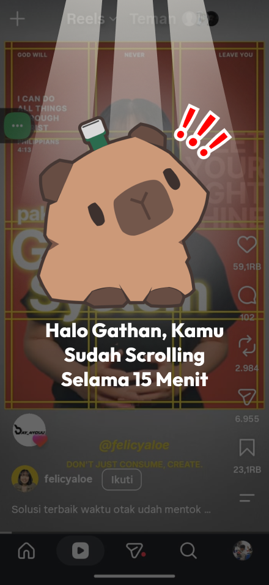
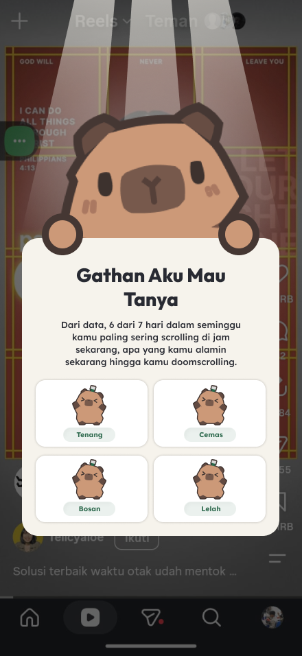
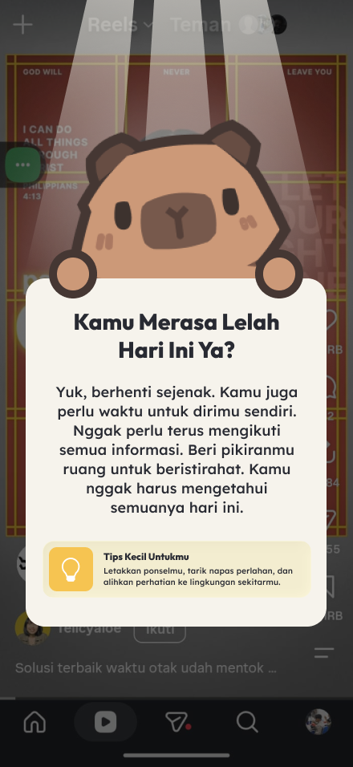
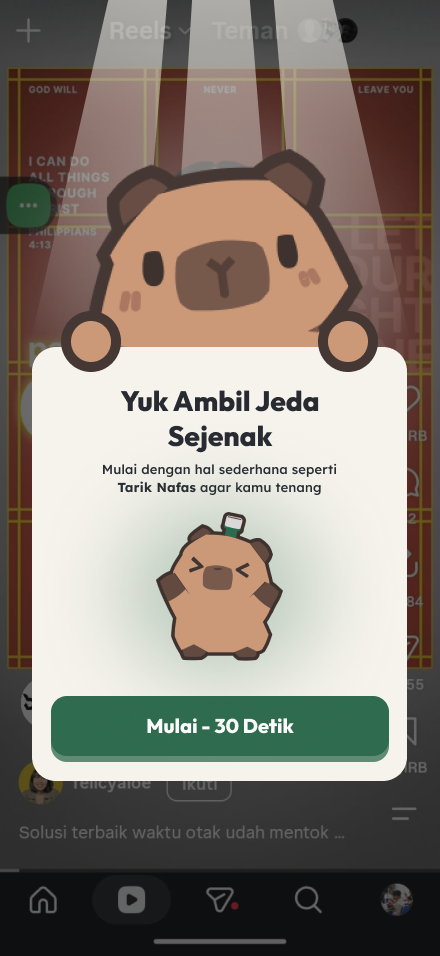
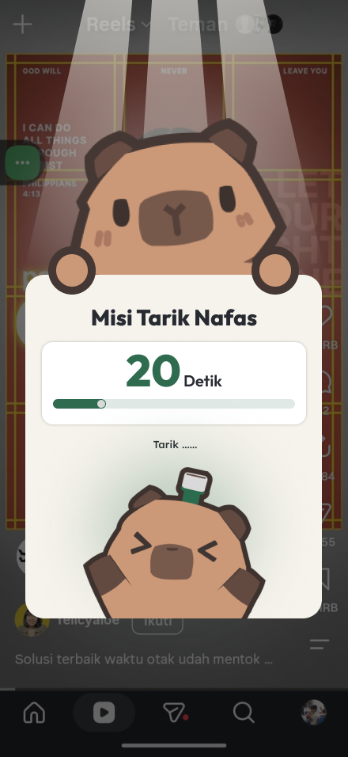
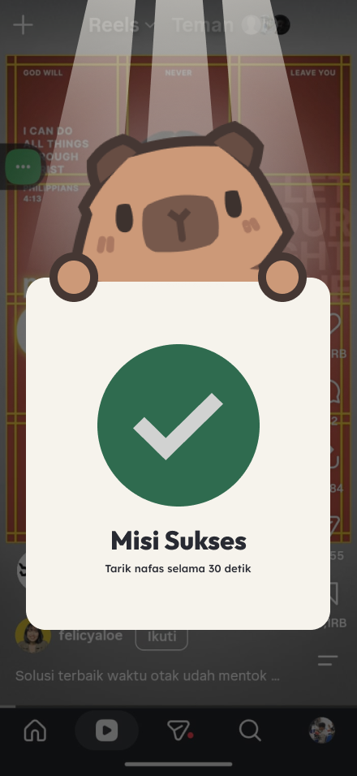
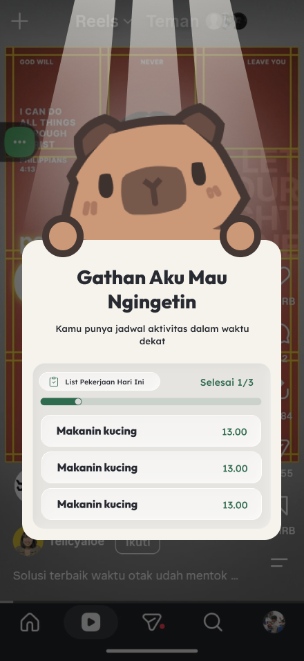
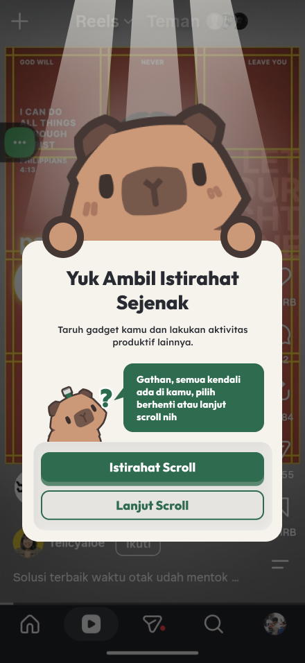
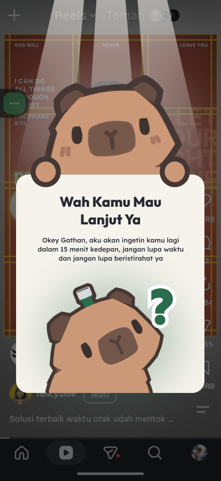

# POP_UP_JEDA_KESADARAN

Dokumentasi visual fitur **POP_UP_JEDA_KESADARAN** pada aplikasi YUDA (Yuk Udahin Doomscrolling Akut).

## Overview

Jeda Kesadaran merupakan mekanisme intervensi preventif pada aplikasi YUDA yang dirancang untuk membantu pengguna mengenali kondisi emosionalnya ketika melakukan aktivitas scrolling pada jam rawan. Melalui pertanyaan mengenai perasaan yang sedang dialami, pengguna diajak untuk mengidentifikasi kondisi dirinya, seperti tenang, cemas, bosan, atau lelah.

Setelah pengguna mengenali kondisi emosionalnya, YUDA menampilkan kartu afirmasi yang berisi kalimat positif dan tips sederhana sebagai bentuk dukungan emosional. Selanjutnya, pengguna diarahkan untuk melakukan aktivitas jeda melalui rangkaian Jeda Pengingat, seperti latihan pernapasan, minum air putih, atau peregangan ringan, serta diberikan kesempatan untuk menentukan apakah ingin beristirahat atau melanjutkan scrolling.

## Screenshots

Berikut merupakan dokumentasi tampilan antarmuka dari fitur POP_UP_JEDA_KESADARAN.

| No | Nama Tampilan | Deskripsi | Tangkapan Layar |
|----|-------|-----------|-----------------|
| 1 | Pop Up Sapaan Pengingat | Menampilkan maskot YUDA yang menyapa pengguna dengan menyertakan nama pengguna dan informasi durasi scrolling yang telah dilakukan. |  |
| 2 | Pop Up Pengenalan Emosi | Menampilkan card yang mengajak pengguna mengenali kondisi emosionalnya saat ini melalui empat pilihan, yaitu tenang, cemas, bosan, dan lelah. |  |
| 3 | Pop Up Kartu Afirmasi | Menampilkan card berisi kalimat afirmasi dan tips sederhana yang disesuaikan sebagai bentuk dukungan emosional serta membantu pengguna menyadari kondisi dirinya. |  |
| 4 | Pop Up Pilihan Aktivitas | Menampilkan card berisi tiga pilihan aktivitas sederhana, yaitu latihan pernapasan selama 30 detik, minum air putih, dan peregangan ringan. Apabila pengguna memasuki rentang waktu tidur (22.00–04.00), sistem juga menyediakan aktivitas tidur. |  |
| 5 | Pop Up Misi | Menampilkan card misi berdasarkan aktivitas yang telah dipilih pengguna sebagai panduan untuk melakukan jeda sejenak dari aktivitas scrolling. |  |
| 6 | Pop Up Konfirmasi Keberhasilan | Menampilkan pesan keberhasilan setelah pengguna menyelesaikan aktivitas yang dipilih sebagai bentuk apresiasi atas partisipasi pengguna dalam mengambil jeda. |  |
| 7 | Pop Up Pengingat Tugas | Menampilkan card pengingat daftar tugas (task list) yang telah dibuat pengguna melalui halaman Daily Planner sebagai dorongan untuk kembali memperhatikan aktivitas yang telah direncanakan. |  |
| 8 | Pop Up Konfirmasi Jeda | Menampilkan dua pilihan kepada pengguna, yaitu Istirahat Scroll untuk mengakhiri aktivitas scrolling sementara atau Lanjut Scroll untuk melanjutkan aktivitas tersebut. |  |
| 9 | Pop Up Pengingat Lanjutan | Menampilkan pesan ketika pengguna memilih untuk melanjutkan scrolling. Sistem kemudian menjadwalkan pengingat jeda berikutnya setelah 15 menit. |  |

## User Flow

1. Pengguna membuka menu [Nama Menu].
2. Pengguna memilih [Aksi].
3. Sistem menampilkan [Hasil].
4. Pengguna dapat [Aksi lanjutan].

## Related Documentation

- [Main README](../../README.md)