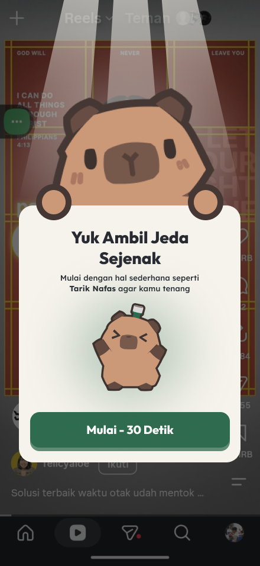
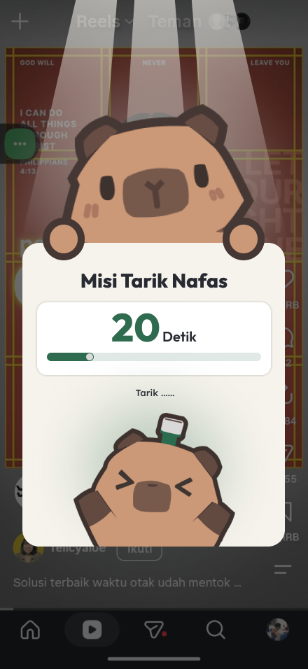
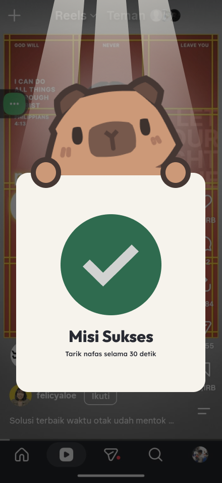
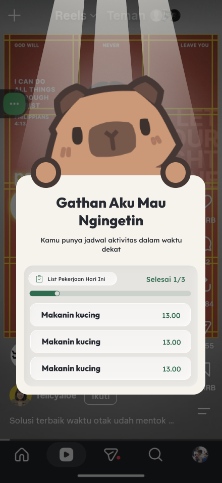
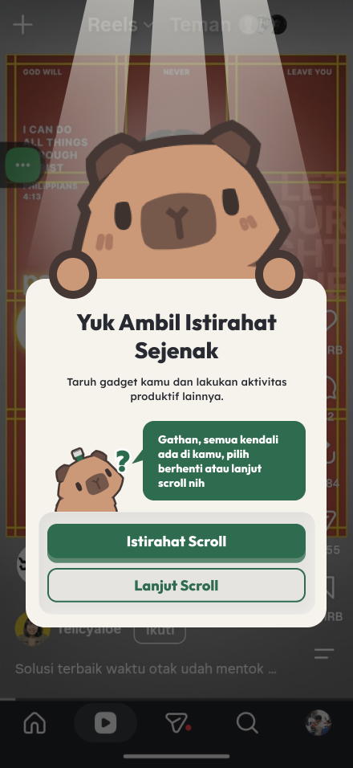
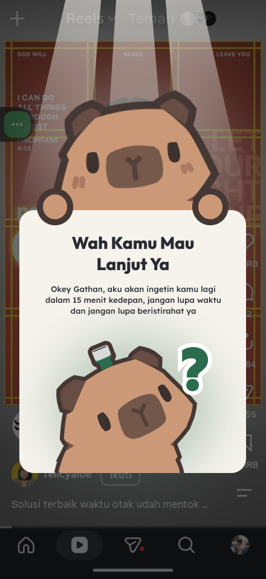
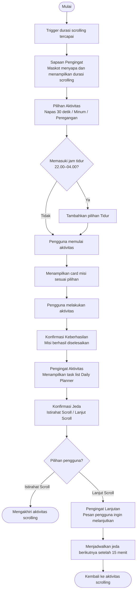

# POP_UP_JEDA_PENGINGAT

Dokumentasi visual fitur **POP_UP_JEDA_PENGINGAT** pada aplikasi YUDA (Yuk Udahin Doomscrolling Akut).

## Overview

Jeda Pengingat merupakan mekanisme intervensi preventif awal pada aplikasi YUDA yang bertujuan membantu pengguna menyadari durasi aktivitas scrolling yang telah dilakukan. Melalui sapaan maskot YUDA yang menampilkan informasi durasi scrolling, pengguna diajak untuk mengambil jeda sejenak dari aktivitas digitalnya.

Fitur ini menyediakan pilihan aktivitas sederhana, seperti latihan pernapasan selama 30 detik, minum air putih, peregangan ringan, hingga tidur pada rentang waktu 22.00–04.00. Selain itu, pengguna juga diberikan pengingat aktivitas melalui Daily Planner serta pilihan untuk beristirahat atau melanjutkan scrolling. Apabila pengguna memilih untuk melanjutkan, YUDA akan memberikan pengingat jeda kembali setelah 15 menit.

## Screenshots

Berikut merupakan dokumentasi tampilan antarmuka dari fitur POP_UP_JEDA_PENGINGAT.

| No | Nama Tampilan | Deskripsi | Tangkapan Layar |
|----|-------|-----------|-----------------|
| 1 | Pop Up Sapaan Pengingat | Menampilkan maskot YUDA yang menyapa pengguna dengan menyertakan nama pengguna dan informasi durasi scrolling yang telah dilakukan. |  |
| 2 | Pop Up Pilihan Aktivitas | Menampilkan card berisi tiga pilihan aktivitas sederhana, yaitu latihan pernapasan selama 30 detik, minum air putih, dan peregangan ringan. Apabila pengguna memasuki rentang waktu tidur (22.00–04.00), sistem juga menyediakan aktivitas tidur. |  |
| 3 | Pop Up Misi | Menampilkan card misi berdasarkan aktivitas yang telah dipilih pengguna sebagai panduan untuk melakukan jeda sejenak dari aktivitas scrolling. |  |
| 4 | Pop Up Konfirmasi Keberhasilan | Menampilkan pesan keberhasilan setelah pengguna menyelesaikan aktivitas yang dipilih sebagai bentuk apresiasi atas partisipasi pengguna dalam mengambil jeda. |  |
| 5 | Pop Up Pengingat Tugas | Menampilkan card pengingat daftar tugas (task list) yang telah dibuat pengguna melalui halaman Daily Planner sebagai dorongan untuk kembali memperhatikan aktivitas yang telah direncanakan. |  |
| 6 | Pop Up Konfirmasi Jeda | Menampilkan dua pilihan kepada pengguna, yaitu Istirahat Scroll untuk mengakhiri aktivitas scrolling sementara atau Lanjut Scroll untuk melanjutkan aktivitas tersebut. |  |
| 7 | Pop Up Pengingat Lanjutan | Menampilkan pesan ketika pengguna memilih untuk melanjutkan scrolling. Sistem kemudian menjadwalkan pengingat jeda berikutnya setelah 15 menit. |  |

## User Flow

## Related Documentation

- [Main README](../../README.md)