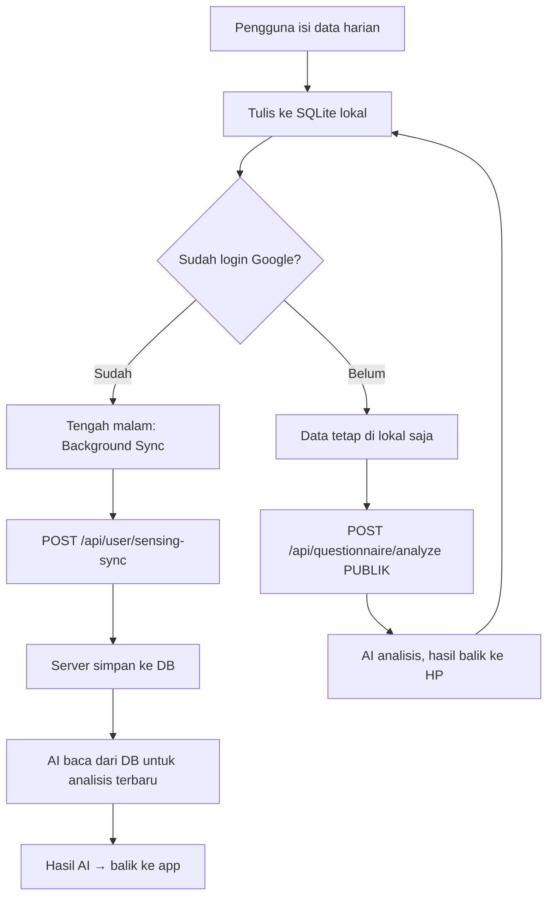

# Arsitektur Guest User: Hybrid Local-First + Background Sync

> Dokumen ini merangkum saran arsitektur untuk pengguna yang memilih "Skip Login" di YUDA,
> berdasarkan diskusi tim — fokus ke sinkronisasi backend & AI yang lancar.

---

## Inti Masalah

Pengguna bisa **skip login Google** di onboarding. Tapi YUDA perlu:
- Terus memperbarui **pola sensing** (emosi, time screen, matrix) hingga 1 bulan ke belakang
- Tetap bisa akses **AI** untuk analisis
- Tidak memaksa pengguna login, tapi **mengamankan data** supaya tidak hilang saat ganti device

---

## Solusi: Hybrid Local-First + Background Sync

**Prinsip utama:**
- 📱 **Local = Primary** — semua data tulis ke HP dulu, bukan ke server
- ☁️ **Cloud = Backup** — server hanya menyimpan salinan aman
- 🔄 **Sync = Otomatis** — terjadi di tengah malam, tanpa ganggu pengguna
- 🔔 **Reminder = Lembut** — ajak tautkan akun, tidak dipaksa

---

## Flow Pengguna

### 1. Skip Login (Guest Mode)
```
Pengguna klik "Lewati" di onboarding
  → Tidak ada request ke backend
  → Langsung masuk ke kuesioner
  → Data jawaban & hasil AI disimpan di SQLite lokal HP
  → Hari ke-7: muncul soft reminder "Simpan progress ke cloud?"
```

### 2. Isi Kuesioner tanpa Login
```
POST /api/questionnaire/analyze   ← endpoint PUBLIC (tanpa token)
  → AI menganalisis jawaban
  → Hasil (archetype, jadwal, afirmasi) dikembalikan ke HP
  → HP simpan hasilnya di SQLite lokal
```

> [!NOTE]
> Endpoint ini tidak memerlukan autentikasi. AI tetap bisa jalan penuh untuk guest.

### 3. Login Google (Kapan Saja)
```
Pengguna klik "Tautkan Akun Google" di Settings
  → Dapat token Sanctum dari backend
  → App cek: ada data lokal yang belum di-sync?
  → Jika ya → kirim sekaligus ke server (one-time bulk sync)
  → Setelah itu: lanjut pakai app seperti biasa
```

### 4. Harian — Pakai App dengan Akun Google
```
Sensing harian → tulis ke SQLite lokal dulu
Tengah malam (background task) → sync ke server
Prune otomatis → hapus data lokal >30 hari yang sudah sukses di-sync
```

### 5. Logout Google
```
Token dihapus dari SecureStore
App tetap jalan normal (data masih di SQLite lokal)
Hanya tidak ada cloud backup sampai login lagi
Progress TIDAK hilang
```

### 6. Ganti Device / Reinstall
```
Install ulang → Login Google → Pull data dari server
  → Server kirim sensing history (semua yang pernah di-sync)
  → App populate SQLite lokal dengan data dari server
```

> [!IMPORTANT]
> Data **HANYA hilang** jika pengguna belum pernah login Google **DAN** uninstall/ganti device.
> Ini sudah dianggap risiko yang wajar dan dikomunikasikan via reminder.

---

## Strategi Supaya Data Lokal Tidak Berat

| Masalah | Solusi |
|---|---|
| Sensing 1 bulan bisa ratusan record | **Rolling window 30 hari** di lokal |
| SecureStore tidak cocok untuk data besar | Gunakan **`expo-sqlite`** untuk sensing data |
| State management membengkak | **Zustand** hanya untuk UI/session state |

**Aturan Rolling Window:**
```
Setiap habis midnight sync yang sukses:
  → Hapus record lokal yang lebih dari 30 hari
  → Data lama tetap aman di server, lokal tetap ringan
```

---

## Sinkronisasi Backend & AI

Ini yang paling penting — supaya **backend dan AI selalu sinkron** meski pengguna guest:



> [!TIP]
> Untuk guest, AI tetap bekerja via endpoint publik. Bedanya hanya **hasil tidak disimpan di server** — hanya di lokal HP.
> Begitu login Google, semua hasil lokal langsung di-sync ke server sehingga AI bisa baca history lengkap.

---

## Conflict Resolution (Kalau Ada Data Bertabrakan)

Misal pengguna pakai 2 device, atau ada data offline yang belum ter-sync:

**Strategi: `last-write-wins` by `updated_at`**

```
Setiap record sensing lokal punya field: local_updated_at (timestamp)

Saat sync ke server:
  → Server bandingkan local_updated_at dengan server updated_at
  → Yang lebih baru → menang
  → Tidak ada yang dihapus paksa
```

---

## Reminder Tautkan Akun (Soft, Tidak Memaksa)

| Trigger | Pesan |
|---|---|
| Hari ke-7 pakai app tanpa login | "YUDA sudah menemanimu 7 hari 🎉 Simpan progress ke cloud supaya tidak hilang jika ganti HP?" |
| Setelah dismiss | Tidak muncul lagi selama 3 hari |
| Setelah 3 hari, muncul lagi | Maksimal 3x total, setelah itu tidak pernah muncul lagi |
| Ganti device & install ulang | "Punya akun Google? Login untuk memulihkan progressmu" |

---

## Endpoint Backend yang Dibutuhkan

| Endpoint | Auth | Fungsi |
|---|---|---|
| `POST /api/questionnaire/analyze` | ❌ Public | Analisis AI untuk guest |
| `POST /api/auth/google` | ❌ Public | Login Google, dapat token |
| `POST /api/user/questionnaire-sync` | ✅ Sanctum | Bulk sync kuesioner saat pertama login |
| `POST /api/user/sensing-sync` | ✅ Sanctum | Nightly sync data sensing |
| `GET /api/user/sensing?after=timestamp` | ✅ Sanctum | Pull data saat ganti device |

---

## Stack Rekomendasi (yuda-app)

| Kebutuhan | Library |
|---|---|
| Sensing data lokal | `expo-sqlite` |
| Session & UI state | `Zustand` |
| Token & secret kecil | `expo-secure-store` |
| Background sync malam | `expo-background-fetch` + `expo-task-manager` |
| Notifikasi reminder | `expo-notifications` |

---

## Kesimpulan

```
Guest mode → data aman di lokal, AI tetap jalan via endpoint publik
Login Google → data lokal otomatis naik ke server, AI baca dari DB
Nightly sync → backend & AI selalu up-to-date tanpa ganggu pengguna
Logout → progress tidak hilang, hanya tidak ada backup cloud sementara
Ganti device → pulihkan dari server dengan login Google
```

> [!NOTE]
> Arsitektur ini tidak mengubah backend yang sudah ada secara besar-besaran.
> Yang perlu ditambah hanya endpoint sync dan logika background task di sisi mobile.
